<div align="center">


**Run coding agents on every machine you own. Watch them from a browser tab.
Answer them from your phone.**

[Docs](docs/index.md) · [Install](#install) · [For agents](SKILL.md)

</div>

<table align="center">
<tr>
<td align="center" valign="top">
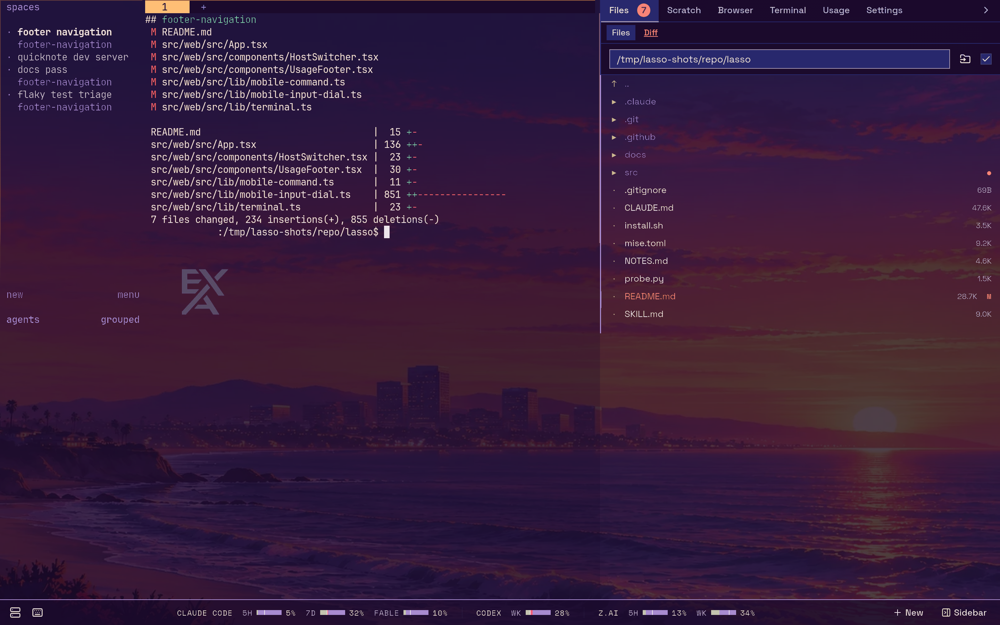
</td>
<td align="center" valign="top">
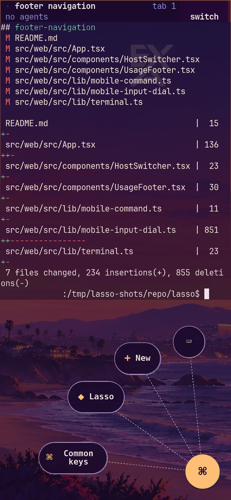
</td>
</tr>
<tr>
<td align="center"><sub>Your desk: the whole fleet, the diff, the files, the budget.</sub></td>
<td align="center"><sub>Pocket: same workspace, real keys.</sub></td>
</tr>
</table>

<p align="center"><sub>Real UI captures from isolated demo workspaces. Identifying details are redacted.</sub></p>

An agent that has been waiting forty minutes on a `y/n` you never saw is an
agent doing nothing. lasso is a single Go binary that puts your coding agents
(every SSH-reachable machine, its [herdr](https://herdr.dev) session, every
pane) in a browser tab, and in a phone app that **buzzes when one of them needs
you**.

- **Your real terminal, anywhere.** Your actual herdr session over `ttyd`, with
  lasso around it, never in front of it.
- **The phone is a first-class client.** A home-screen app that opens on an
  Inbox of what is waiting on you, answered with a tap or by dictation; the
  full UI is a switch away, with a radial dial for Esc/Ctrl-C/Tab/arrows and
  photo upload straight to the agent's host.
- **A Mac app.** Lasso for the Mac keeps that Inbox on the edge of your
  screen, with a window per agent and a shortcut to start one from anywhere.
- **It tells you when an agent is stuck.** Web Push to a locked phone when an
  agent blocks on an approval or a question, on any host. Each device picks
  what may interrupt it.
- **The sidebar follows the focused pane.** A file editor and live git diff on
  the machine that pane is actually working on.
- **A browser you and your agents share.** A real Chromium you watch and click
  in while an agent drives it.
- **Bots that stay up.** Long-lived Claude Code sessions with their own
  folder, MCP servers, channels and encrypted secrets, read like a messaging
  app, with a push when one answers and an installable Bots app. Ask a bot to
  change its own settings and it can.
- **Agents orchestrating agents.** An MCP server lets one agent spawn, list,
  inspect and close the others, across the fleet, and `/herdr-mcp` serves
  herdr's own API as MCP tools on any host (no separate herdr-mcp to run).

## What it looks like

<table>
  <tr>
    <td width="33%" align="center" valign="top">
      <a href="docs/assets/readme/terminal.webp">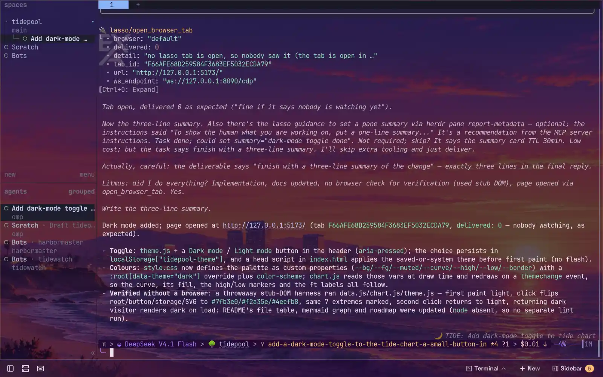</a><br>
      <b>Your real herdr terminal</b><br>
      <a href="docs/web-ui/terminal.md#the-herdr-terminal">The herdr terminal →</a>
    </td>
    <td width="33%" align="center" valign="top">
      <a href="docs/assets/readme/desktop.webp"></a><br>
      <b>The Mac app: an edge rail, an inbox of what's waiting, agent windows</b><br>
      <a href="docs/getting-started/desktop.md">Mac app →</a> ·
      <a href="docs/getting-started/desktop.md#using-it">the Inbox</a>
    </td>
    <td width="33%" align="center" valign="top">
      <a href="docs/assets/readme/grid.webp">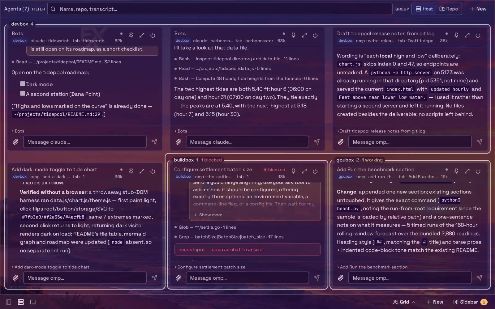</a><br>
      <b>Every agent at once</b><br>
      <a href="docs/web-ui/terminal.md#grid">Grid →</a>
    </td>
  </tr>
  <tr>
    <td width="33%" align="center" valign="top">
      <a href="docs/assets/readme/bots.webp">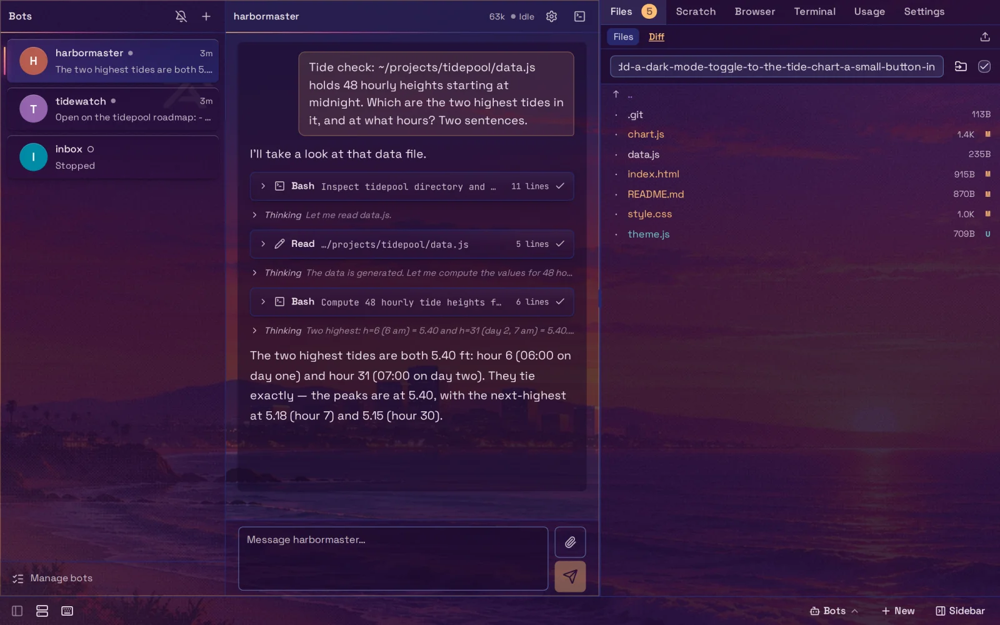</a><br>
      <b>Bots that stay up</b><br>
      <a href="docs/web-ui/bots.md#the-list">Bots →</a> ·
      <a href="docs/web-ui/bots.md#talking-to-a-bot">talking to one</a>
    </td>
    <td width="33%" align="center" valign="top">
      <a href="docs/assets/readme/files.webp">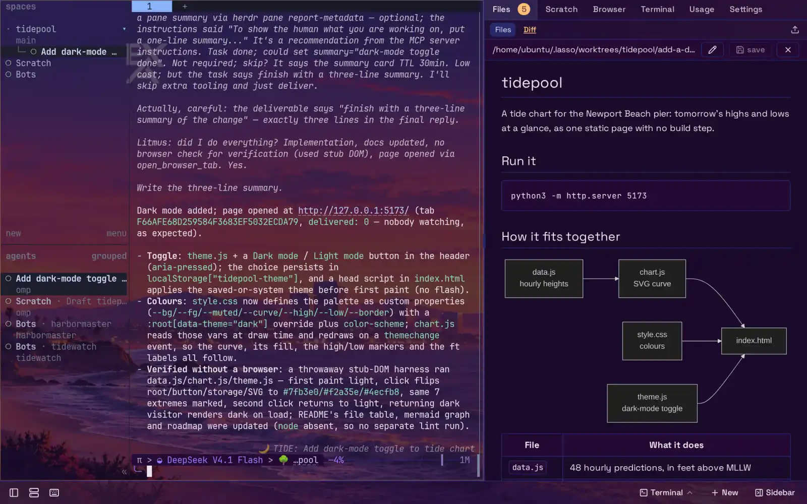</a><br>
      <b>Files follow the focused pane</b><br>
      <a href="docs/web-ui/sidebar.md#files">Files →</a> ·
      <a href="docs/concepts/hosts.md#the-sidebar-follows-the-pane-not-just-the-tab">on any host</a>
    </td>
    <td width="33%" align="center" valign="top">
      <a href="docs/assets/readme/chat.webp">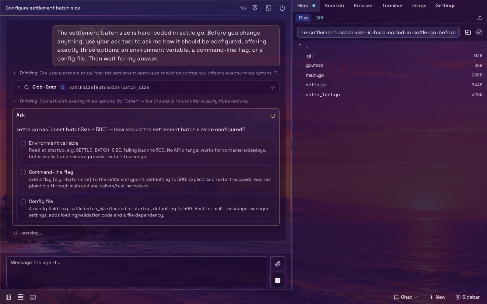</a><br>
      <b>Read and answer it as a chat</b><br>
      <a href="docs/web-ui/terminal.md#chat-view">Chat view →</a>
    </td>
  </tr>
  <tr>
    <td width="33%" align="center" valign="top">
      <a href="docs/assets/readme/browser.webp">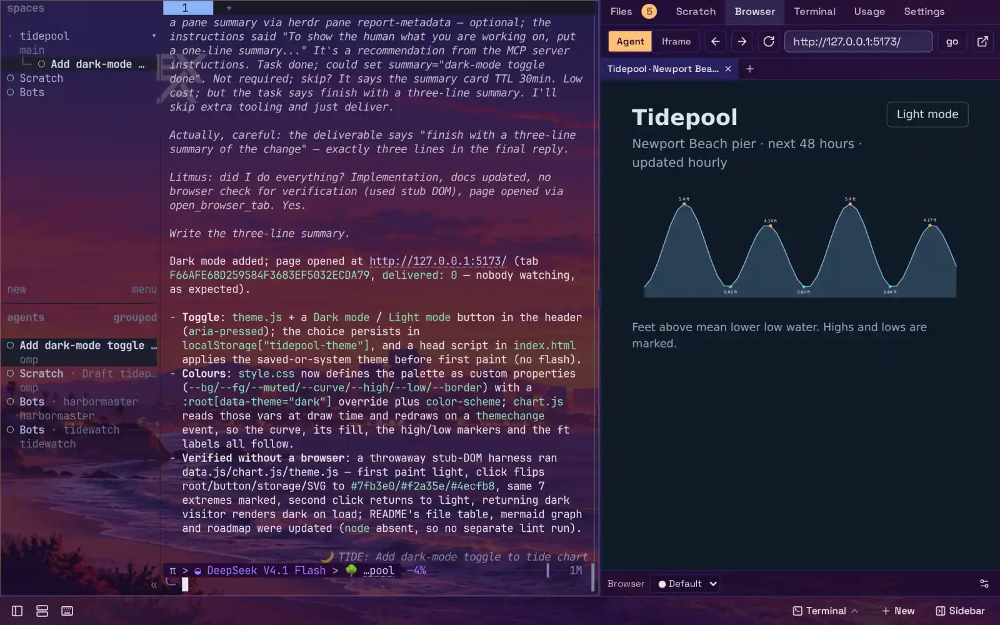</a><br>
      <b>A browser you share with agents</b><br>
      <a href="docs/concepts/shared-browser.md#what-you-and-agents-each-see">Shared browser →</a> ·
      <a href="docs/web-ui/sidebar.md#browser">Browser tab</a>
    </td>
    <td width="33%" align="center" valign="top">
      <a href="docs/assets/readme/new-agent.webp">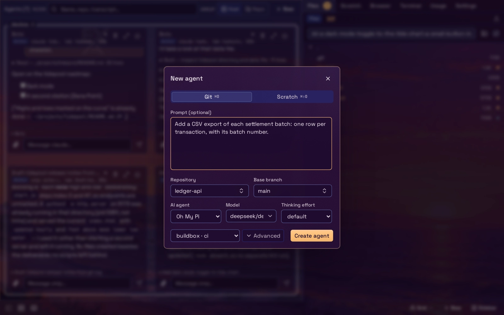</a><br>
      <b>Start an agent on any host</b><br>
      <a href="docs/web-ui/new-agent.md#the-agent-form">New dialog →</a> ·
      <a href="docs/web-ui/new-agent.md#choosing-the-host">choosing the host</a>
    </td>
    <td width="33%" align="center" valign="top">
      <a href="docs/assets/readme/hosts.webp">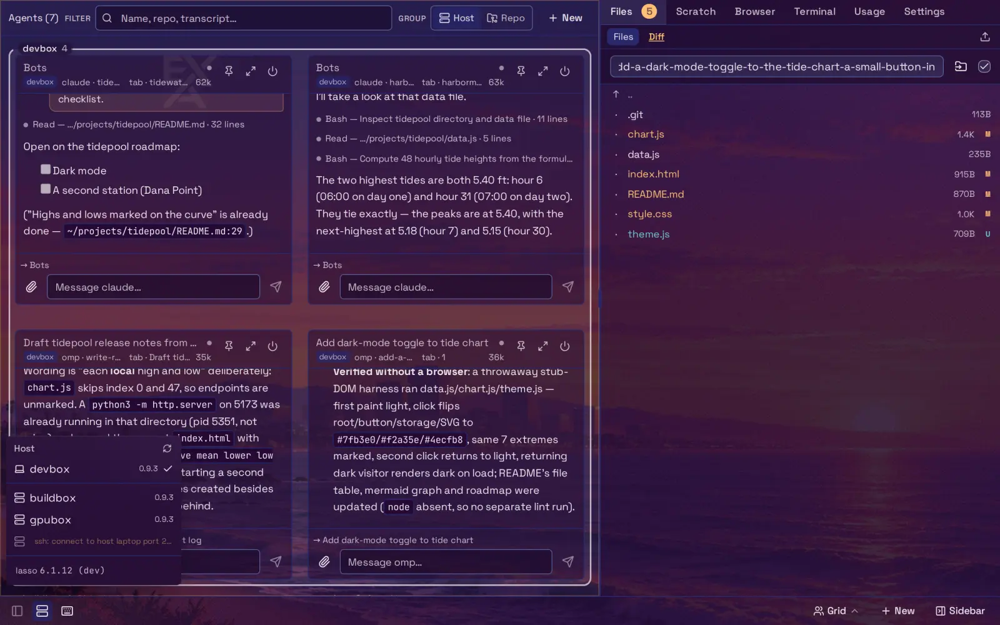</a><br>
      <b>One lasso, every machine</b><br>
      <a href="docs/concepts/hosts.md#how-the-host-menu-groups-them">Hosts →</a>
    </td>
  </tr>
  <tr>
    <td width="33%" align="center" valign="top">
      <a href="docs/assets/readme/mcp.webp">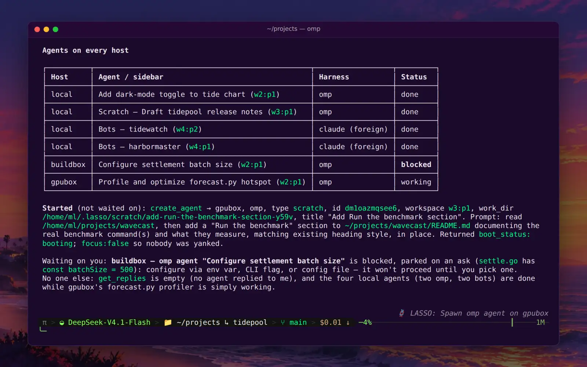</a><br>
      <b>Agents orchestrating agents</b><br>
      <a href="docs/mcp/index.md#two-servers">MCP server →</a> ·
      <a href="docs/mcp/cli.md#lasso-mcp">lasso mcp</a>
    </td>
    <td width="33%" align="center" valign="top">
      <a href="docs/assets/readme/phone.webp">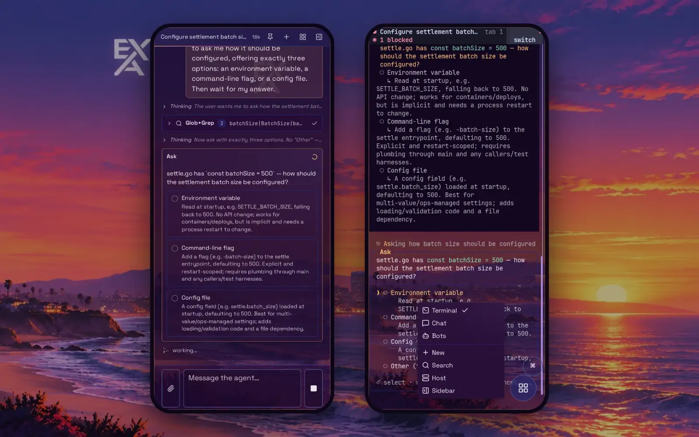</a><br>
      <b>Answer from your phone</b><br>
      <a href="docs/getting-started/phone.md">Phone app →</a> ·
      <a href="docs/web-ui/terminal.md#the-input-dial-phones-and-narrow-windows">input dial</a>
    </td>
    <td width="33%" align="center" valign="top">
      <a href="docs/assets/readme/plugins.webp">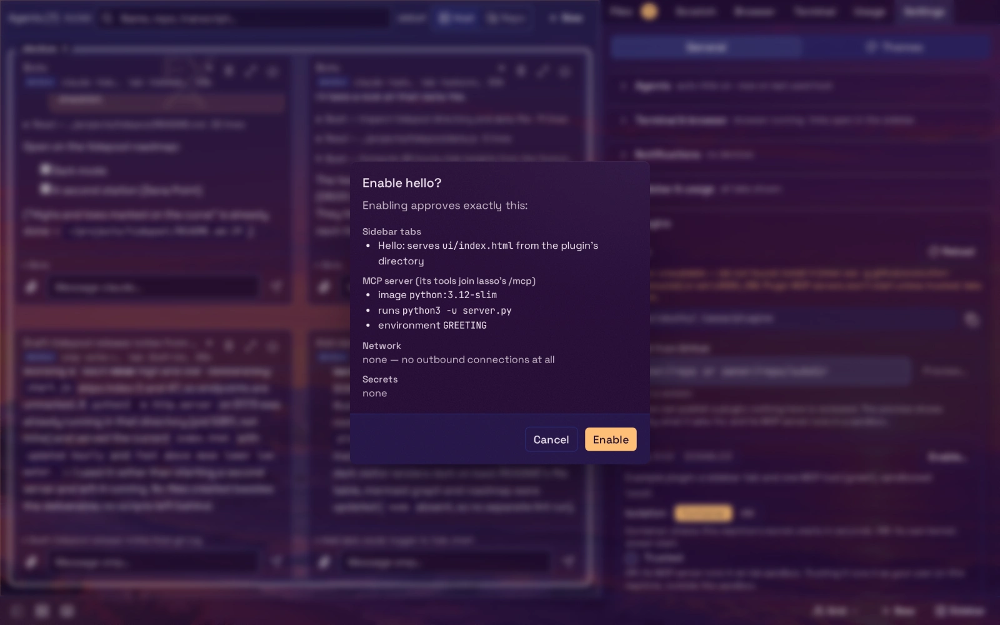</a><br>
      <b>Plugins you approve</b><br>
      <a href="docs/plugins/index.md">Plugins →</a> ·
      <a href="docs/plugins/index.md#the-trust-model">trust model</a>
    </td>
  </tr>
</table>

<p align="center"><sub>Taken from a demo lasso in a throwaway VM, with real omp agents at work on three machines. <code>mise run readme:shots</code> retakes them, all but the Mac app, which comes from its own renders of sample data.</sub></p>

## Install

```bash
curl -fsSL https://executionassociates.com/install-lasso | sh
lasso start                 # run it in the background
open http://127.0.0.1:8090
```

lasso needs [herdr](https://herdr.dev) and [ttyd](https://github.com/tsl0922/ttyd) on
the same machine. Run `lasso doctor`
if anything looks off. Then register lasso's MCP servers with the agent CLIs on
the machine:

```bash
lasso connect
```

### The Mac app

[Download Lasso for the Mac](https://github.com/execution-associates/lasso/releases/latest/download/Lasso.dmg)
for a Mac with Apple silicon on macOS 14 or later, and drag it onto
Applications. It keeps lasso's Inbox on the edge of your screen and connects to
a lasso you already run, on the same Mac or another machine: first launch asks
for its address. It is signed, notarized and updates itself.
[The Mac app](docs/getting-started/desktop.md) has the details.

### Reach it from your other devices

lasso listens on loopback only. To reach it from your phone or another
machine, serve it on your tailnet with `lasso serve -tailnet`
([Tailscale](docs/deployment/tailnet.md)), or publish it through a Cloudflare
tunnel and Access with `-listen-access` ([Cloudflare](docs/deployment/cloudflare.md)).
Both serve HTTPS, which the phone app and push need, and lasso checks who is
calling on every request. Read the [security model](docs/security.md) first;
the terminal is a writable shell and lasso never belongs on a public interface.

## Documentation

| | |
| --- | --- |
| [Getting started](docs/getting-started/index.md) | Install, first run, connecting agents, the phone app, the Mac app |
| [Concepts](docs/concepts/index.md) | Hosts, agents and worktrees, the shared browser, notifications |
| [Web UI](docs/web-ui/index.md) | The terminal, the sidebar, the New dialog, theming, bots |
| [MCP server](docs/mcp/index.md) | Tools (the browser tools among them), the herdr MCP, the CLI, OAuth, agent scope |
| [Plugins](docs/plugins/index.md) | Installing plugins, and [writing one](docs/plugins/authoring.md) |
| [Deployment](docs/deployment/index.md) | systemd, Cloudflare Tunnel and Access, tailnet, updating |
| [Security](docs/security.md) · [Troubleshooting](docs/troubleshooting.md) | |
| [Reference](docs/reference/index.md) | CLI, configuration, files, HTTP routes, architecture, development |

Agents working with lasso should read [SKILL.md](SKILL.md).

## Building from source

```bash
mise run build      # build the frontend (src/web/dist) then the binary
./lasso             # serves on 127.0.0.1:8090
```

Frontend tooling runs inside a per-worktree incus container, never on the host.
See [Development](docs/reference/development.md).

## License

lasso is licensed under the [Apache License 2.0](LICENSE), the same license as
herdr. See [NOTICE](NOTICE) for the copyright notice.
