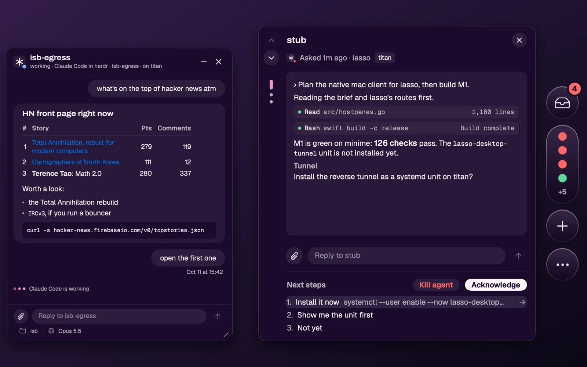

Lasso is the native macOS app for a running lasso. It lives on the edge of your screen instead of in a browser tab: a rail you reveal with the pointer, an **Inbox** of what is waiting on you across every machine, a window per agent, and your bots' conversations. It talks to lasso over the same HTTP API as the web UI, so everything it shows is on the lasso you point it at; the app keeps no agents of its own.

## Requirements

- A Mac with Apple silicon, on macOS 14 or later.
- **lasso 7.0.0 or later**, which the Mac can reach: on the same Mac, on your tailnet, or behind Cloudflare Access. The app will not connect to an older lasso; update it with `lasso update`. See [Deployment](../deployment/index.md).

## Install

[Download Lasso for the Mac](https://github.com/execution-associates/lasso/releases/latest/download/Lasso.dmg), the newest release's DMG. Every lasso release on [GitHub](https://github.com/execution-associates/lasso/releases/latest) carries it, as `Lasso.dmg` and as `Lasso-<version>.dmg`, at lasso's own version. Open the DMG and drag **Lasso** onto **Applications**. The app is signed with a Developer ID and notarized by Apple, so it opens without a Gatekeeper warning, and it updates itself from then on.

On first launch the app looks for a lasso at the address it last used and at `127.0.0.1:8090`. If neither answers, a first-run panel asks for your lasso's address; when one does, it says so and shows a few tips. Until a lasso answers, the rail's inbox shows a grey **!** and opens that panel.

## Connect it to your lasso

Type the address in the first-run panel, or later in Settings › Info, which names the lasso the app uses by its machine: **Change…** opens the address field there. Press **Connect**.

- A bare hostname (`titan.example.ts.net`, `lasso.example.com`) means `https://`. `127.0.0.1` and `localhost` mean `http://`, for a lasso on the same Mac.
- The app asks lasso what proof it needs, and signs in the way that lasso's network expects:
  - **On the same Mac, or on your tailnet** (`-tailnet`): nothing to sign in to. The tailnet already says who the Mac belongs to.
  - **Behind Cloudflare Access** (`-listen-access`): your browser opens Access's sign-in once, then lands back in the app. The app keeps the tokens in the Keychain and refreshes them itself.
  - **On a lasso with `MCP_OAUTH`** and no edge in front: the same browser sign-in, against lasso's own consent screen.
  - **A lasso that uses `UI_AUTH`**: the app asks for its user and password, checks them against lasso, and keeps them in the Keychain.
- When a sign-in runs out and cannot be refreshed, Settings shows **Sign in again**, and everything on screen stays as it was until you do. **Sign out** forgets that lasso's tokens.

The app uses one lasso at a time. [Security](../security.md) and [Authentication](../design/auth.md) describe what each network proves.

## Using it

- **The rail.** Move the pointer to the screen edge to reveal it. Its dot shows the most urgent state across your agents.
- **The Inbox** lists the questions agents are asking, agents blocked with nothing to pick from, finished turns and lasso's notices, newest first within each. Answer a question in place, reply to a finished turn, **Acknowledge** what needs nothing more, or open the agent's window. Acknowledge (**A**) or **Kill** (**X** twice) takes the entry off the Inbox at once and moves to the next one. **J** and **K** page, **R** renames the agent, **L** puts the cursor in the reply box, **T** shows the agent in herdr's terminal window, and **esc** closes. The keys are not drawn on screen. The rest: **U** attaches a file, **⏎** puts the cursor in the reply box (or sends what it holds), **1**–**9** pick one of the agent's choices, **→** answers with it, **Tab** puts it in the reply box to edit first, and **⌘.** stops an agent that is working. Acknowledge waits while you have a reply typed: send or clear it first. A kill can take a few seconds: until it is done the button reads **Killing…**, the conversation dims, and only **J**, **K** and **esc** work. If it fails, the card says why. The Inbox and the phone's [simple app](./phone.md#the-simple-app) follow the same rules over lasso's own state, so for the same lasso both list the same things and the rail's count is the phone's. Acknowledge is shared by every device, and so are lasso's notices. Finished turns count from the moment that lasso started keeping an Inbox, not from when the app was installed.
- **Agents.** The agents list groups your agents by workspace; its **New** button opens the New form. Hover one for a preview, click it for its own window. One row is lit at a time: the one under the pointer, or the one **↑**/**↓** moved to until the pointer moves. The Inbox, the agents list and a preview open when the pointer rests on the rail and close when it leaves the rail and them. Clicking the rail's buttons gives them the keyboard but does not keep them open. A reply you had started is kept for that agent. Opened by a shortcut, the Inbox waits for the pointer, **esc** or a click elsewhere. Clicking an agent opens its own window, which stays open until you close it. The window's **Kill agent** button, at the bottom right, asks you to press it again (or **X** twice), then ends the agent and closes the window. Click an agent's name, or right-click it, to **Rename** it; the name becomes the agent's herdr label. A window takes the same keys as the Inbox (**R**, **L**, **T**, **X** twice), without paging or Acknowledge, and **⌘W** closes it. Drag its bottom-right corner to resize it; double-click the corner for the default size. A preview takes typing once you click into it.
- **herdr.** The terminal button on the rail, between Bots and the globe, opens lasso's herdr in a window of its own, signed in the way the app is. An agent's header button (or **T**) focuses that agent's pane there. herdr's focus is shared, so this moves it for every client, as picking a pane in the web app does. **⌘+** (or **⌘=**) and **⌘-** make the terminal's text bigger and smaller, one point at a time between 8 and 32, and **⌘0** returns it to lasso's 14. The app remembers the size for every terminal window. A new size changes the terminal's columns and rows, which herdr shares with every client, so it takes the size over from a browser tab the way typing does. The window behaves like an agent's: it stays in front of other apps, maximized and full-screen ones included, comes with you when you switch desktops, and stays open until you close it with **⌘W** or its ✕. Typing goes to the terminal as soon as it opens or you click in it, while the app you were in stays in front. Drag its header to move it and its bottom-right corner to resize it (double-click the corner for the default size); the minimize button folds it to its header. It has no full screen: a window on every desktop cannot have one.
- **Browser.** The globe on the rail, between the terminal button and **+**, opens lasso's browsers in a window of their own: the web app's [Browser tab](../web-ui/sidebar.md#browser) in its Agent view, signed in the way the app is. The bar at the top picks which of the lasso's browsers it shows. Below it are the browser's toolbar (back, forward, reload, an address, and ↗ to open the page in your Mac's browser), its pages as tabs (✕ closes one, **+** opens one) and the page itself, live: clicks, scrolling and typing go to the real browser, which agents may be using too. It is the same kind of window as herdr's: in front of other apps, with you on every desktop, moved by its bar, resized by its corner, folded to its bar by minimize, never full screen, and open until **⌘W** or its ✕ closes it. When an agent opens a page for you, the globe pulses and a banner beside the rail says who opened which page, with **Dismiss** and **Open**. Nothing opens until you click **Open** or the globe, and the banner never takes the keyboard. With the Browser window already in view, the page simply appears in it.
- **New agents and terminals.** **⌥⇧O** starts an agent in a repository, **⌃⇧O** a scratch agent and **⌥⇧I** a terminal, from any app. **⌘O**, **⌘⇧O** and **⌘I** do the same while the app has the keyboard. The **New** form is the web UI's [New dialog](../web-ui/new-agent.md), with three modes: **In a repository**, **Scratch** and **Terminal**. Creating an agent opens its window with the cursor in its message box, so you can write to it while it starts. In Terminal mode the box takes a command (blank opens a shell; several lines run as one script), with the machine and an optional working directory. **Run** opens a new herdr tab running it and shows that tab in herdr's terminal window.
- **Bots.** Your [bots](../web-ui/bots.md) have a button on the rail (two speech bubbles), under the agents. Its dot is red while one asks or failed, and blue while one works. Rest on it for the Bots column, which lists bots asking first, then working, failed, idle and stopped. Rest on a bot for its latest exchange, or click it for its own window, which stays open. A bot's preview and window are an agent's: the same header with the terminal button (it shows the bot's pane in herdr's window; a stopped bot has none to show, and the button says so), minimize and close, the same message box (paste and drop attach, **⌘.** stops, **⌘W** closes), and a preview takes typing once you click into it. There you can chat with the bot, answer its questions, stop a turn (**⌘.**), switch an omp bot's model, start a new conversation or go back to an earlier one, and start, stop or restart the bot. Creating and configuring bots stays in the web app: **Manage bots ↗** and **Settings ↗** open it.
- **Stop.** While an agent or bot is working and you have typed nothing, the send button is a **Stop** square. Click it, or press **⌘.**, to interrupt the turn, as Escape does in its terminal. Typing brings Send back.
- **Files and screenshots.** The paperclip (**U**) next to any message box attaches files. Pasting (**⌘V**) or dropping files or an image into a message box, or into the New Agent prompt, does the same. Each file is copied to the machine the agent runs on (for a new agent, the machine you picked), and the message carries its path there, never a path on your Mac. A pasted image goes as a PNG. Folders, empty files and files over 1 GiB are refused with a note saying why. Plain text pastes as text.
- **Shortcuts.** **⌥Space** opens the Inbox with the keyboard in it. Settings › Shortcuts changes any shortcut, including a double tap of ⌥, ⌘ or ⌃ (which needs the Accessibility permission).
- **Sounds.** A sound plays when something new arrives in the Inbox. Pick one of three, or upload your own in Settings; an uploaded sound is stored on lasso and every Mac using that lasso plays it.
- **Dock and menu bar.** Settings › Info chooses whether the app shows in the Dock and in the menu bar (with the Inbox's count), and has **Quit**.
- **Rail position.** Drag the rail up or down its edge to move it. **Center vertically** in Settings › Info puts it back in the middle.
- **Start at login.** Finishing the first-run setup adds Lasso to your login items once, so the rail is there after a restart; macOS says so in a notification. Turn it off with **Start at login** in Settings › Info, or in System Settings › General › Login Items. Lasso then stays off until you turn it on again. If macOS asks you to allow it, **Open Login Items** takes you there.

## Notifications

The Mac is a notification device of its own, registered as "Lasso on <your Mac>". Settings › Notifications lists the same **Notify me about** choices as the web UI, and a sound plays only for a kind this Mac wants. A choice never hides anything from the Inbox. See [Notifications](../concepts/notifications.md#choosing-what-interrupts-each-device).

## Updates

The app updates itself with [Sparkle](https://sparkle-project.org). It checks the newest lasso release's update feed, verifies the download's signature against the key built into the app, and installs it. **Check for updates** in Settings › Info checks now.

Keep the app and lasso at the same release where you can: the app is built against that release's API, and a newer app against an older lasso shows less (no notification choices, for example) rather than failing.
